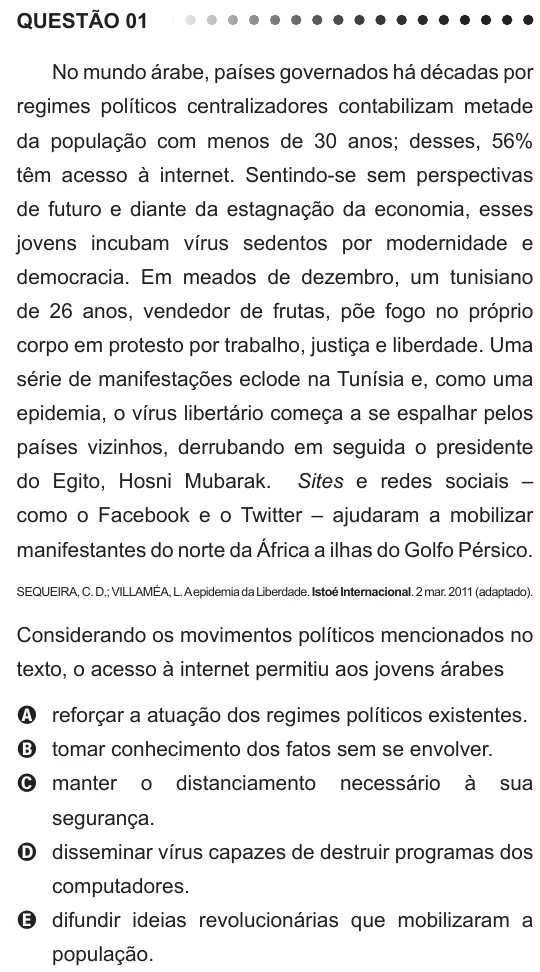

Texto extraído (pode conter ruído)

QUESTÃO 01  
No mundo árabe, países governados há décadas por  
regimes políticos centralizadores contabilizam metade  
da população com menos de 30 anos; desses, 56%  
têm acesso à internet. Sentindo-se sem perspectivas  
de futuro e diante da estagnação da economia, esses  
jovens incubam vírus sedentos por modernidade e  
democracia. Em meados de dezembro, um tunisiano  
de 26 anos, vendedor de frutas, põe fogo no próprio  
corpo em protesto por trabalho, justiça e liberdade. Uma  
série de manifestações eclode na Tunísia e, como uma  
epidemia, o vírus libertário começa a se espalhar pelos  
países vizinhos, derrubando em seguida o presidente  
do Egito, Hosni Mubarak.  
Sites e redes sociais –  
como o Facebook e o Twitter – ajudaram a mobilizar  
manifestantes do norte da África a ilhas do Golfo Pérsico.  
SEQUEIRA, C. D.; VILLAMÉA, L. A epidemia da Liberdade. Istoé Internacional. 2 mar. 2011 (adaptado).  
Considerando os movimentos políticos mencionados no  
texto, o acesso à internet permitiu aos jovens árabes  
A reforçar a atuação dos regimes políticos existentes.  
B tomar conhecimento dos fatos sem se envolver.  
C manter  
o  
distanciamento  
necessário  
à  
sua  
segurança.  
D disseminar vírus capazes de destruir programas dos  
computadores.  
E difundir ideias revolucionárias que mobilizaram a  
população.

