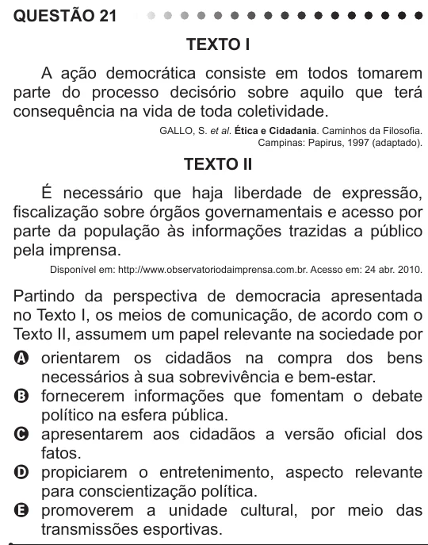

Texto extraído (pode conter ruído)

QUESTÃO 21  
Texto I  
A ação democrática consiste em todos tomarem  
parte do processo decisório sobre aquilo que terá  
consequência na vida de toda coletividade.  
GALLO, S. et al. Ética e Cidadania. Caminhos da Filosofia.  
Campinas: Papirus, 1997 (adaptado).  
Texto II  
É necessário que haja liberdade de expressão,  
fiscalização sobre órgãos governamentais e acesso por  
parte da população às informações trazidas a público  
pela imprensa.  
Disponível em: http://www.observatoriodaimprensa.com.br. Acesso em: 24 abr. 2010.  
Partindo da perspectiva de democracia apresentada  
no Texto I, os meios de comunicação, de acordo com o  
Texto II, assumem um papel relevante na sociedade por  
A orientarem os cidadãos na compra dos bens  
necessários à sua sobrevivência e bem-estar.  
B fornecerem informações que fomentam o debate  
político na esfera pública.  
C apresentarem aos cidadãos a versão oficial dos  
fatos.  
D propiciarem o entretenimento, aspecto relevante  
para conscientização política.  
E promoverem a unidade cultural, por meio das  
transmissões esportivas.

