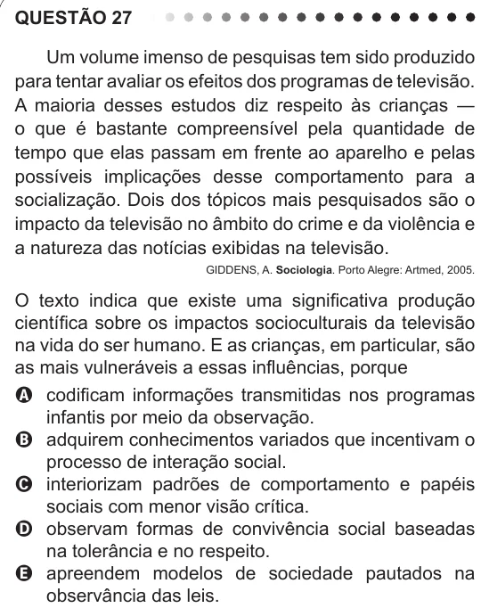

Texto extraído (pode conter ruído)

QUESTÃO 27  
Um volume imenso de pesquisas tem sido produzido  
para tentar avaliar os efeitos dos programas de televisão.  
A maioria desses estudos diz respeito às crianças ―  
o que é bastante compreensível pela quantidade de  
tempo que elas passam em frente ao aparelho e pelas  
possíveis implicações desse comportamento para a  
socialização. Dois dos tópicos mais pesquisados são o  
impacto da televisão no âmbito do crime e da violência e  
a natureza das notícias exibidas na televisão.  
GIDDENS, A. Sociologia. Porto Alegre: Artmed, 2005.  
O texto indica que existe uma significativa produção  
científica sobre os impactos socioculturais da televisão  
na vida do ser humano. E as crianças, em particular, são  
as mais vulneráveis a essas influências, porque  
A codificam informações transmitidas nos programas  
infantis por meio da observação.  
B adquirem conhecimentos variados que incentivam o  
processo de interação social.  
C interiorizam padrões de comportamento e papéis  
sociais com menor visão crítica.  
D observam formas de convivência social baseadas  
na tolerância e no respeito.  
E apreendem modelos de sociedade pautados na  
observância das leis.

