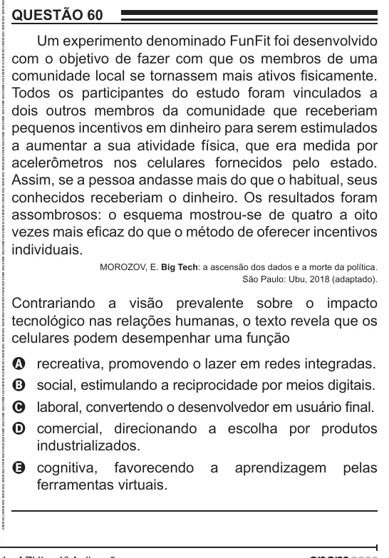

Texto extraído (pode conter ruído)

QUESTÃO 60  
Um experimento denominado FunFit foi desenvolvido  
com o objetivo de fazer com que os membros de uma  
comunidade local se tornassem mais ativos fisicamente.  
Todos os participantes do estudo foram vinculados a  
dois outros membros da comunidade que receberiam  
pequenos incentivos em dinheiro para serem estimulados  
a aumentar a sua atividade física, que era medida por  
acelerômetros nos celulares fornecidos pelo estado.  
Assim, se a pessoa andasse mais do que o habitual, seus  
conhecidos receberiam o dinheiro. Os resultados foram  
assombrosos: o esquema mostrou-se de quatro a oito  
vezes mais eficaz do que o método de oferecer incentivos  
individuais.  
MOROZOV, E. Big Tech: a ascensão dos dados e a morte da política.  
São Paulo: Ubu, 2018 (adaptado).  
Contrariando a visão prevalente sobre o impacto  
tecnológico nas relações humanas, o texto revela que os  
celulares podem desempenhar uma função  
recreativa, promovendo o lazer em redes integradas.  
A  
B  
social, estimulando a reciprocidade por meios digitais.  
laboral, convertendo o desenvolvedor em usuário final.  
C  
comercial, direcionando a escolha por produtos  
D  
industrializados.  
E cognitiva, favorecendo a aprendizagem pelas  
ferramentas virtuais.

