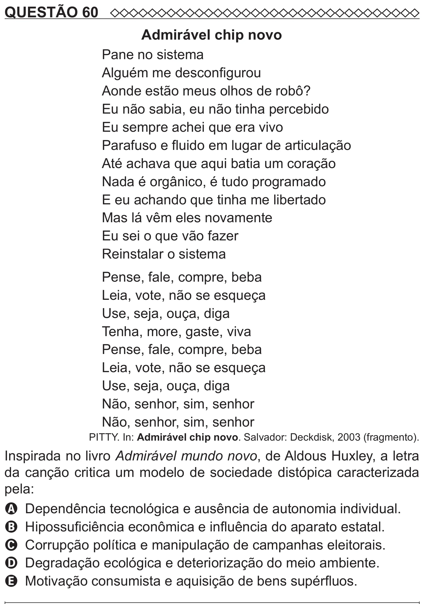

Texto extraído (pode conter ruído)

QUESTÃO 60  
Admirável chip novo  
Pane no sistema  
Alguém me desconfigurou  
Aonde estão meus olhos de robô?  
Eu não sabia, eu não tinha percebido  
Eu sempre achei que era vivo  
Parafuso e fluido em lugar de articulação  
Até achava que aqui batia um coração  
Nada é orgânico, é tudo programado  
E eu achando que tinha me libertado  
Mas lá vêm eles novamente  
Eu sei o que vão fazer  
Reinstalar o sistema  
Pense, fale, compre, beba  
Leia, vote, não se esqueça  
Use, seja, ouça, diga  
Tenha, more, gaste, viva  
Pense, fale, compre, beba  
Leia, vote, não se esqueça  
Use, seja, ouça, diga  
Não, senhor, sim, senhor  
Não, senhor, sim, senhor  
PITTY. In: Admirável chip novo. Salvador: Deckdisk, 2003 (fragmento).  
Inspirada no livro Admirável mundo novo, de Aldous Huxley, a letra  
da canção critica um modelo de sociedade distópica caracterizada  
pela:  
A Dependência tecnológica e ausência de autonomia individual.  
B Hipossuficiência econômica e influência do aparato estatal.  
C Corrupção política e manipulação de campanhas eleitorais.  
D Degradação ecológica e deteriorização do meio ambiente.  
E Motivação consumista e aquisição de bens supérfluos.

