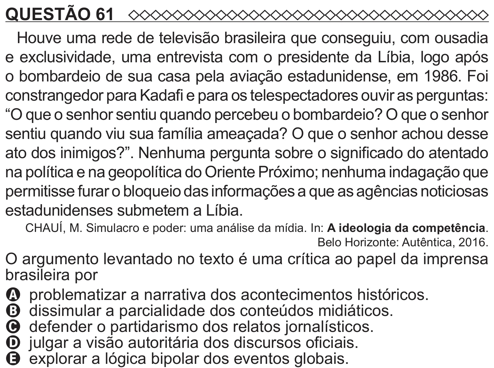

Texto extraído (pode conter ruído)

QUESTÃO 61  
Houve uma rede de televisão brasileira que conseguiu, com ousadia  
e exclusividade, uma entrevista com o presidente da Líbia, logo após  
o bombardeio de sua casa pela aviação estadunidense, em 1986. Foi  
constrangedor para Kadafi e para os telespectadores ouvir as perguntas:  
“O que o senhor sentiu quando percebeu o bombardeio? O que o senhor  
sentiu quando viu sua família ameaçada? O que o senhor achou desse  
ato dos inimigos?”. Nenhuma pergunta sobre o significado do atentado  
na política e na geopolítica do Oriente Próximo; nenhuma indagação que  
permitisse furar o bloqueio das informações a que as agências noticiosas  
estadunidenses submetem a Líbia.  
CHAUÍ, M. Simulacro e poder: uma análise da mídia. In: A ideologia da competência.  
Belo Horizonte: Autêntica, 2016.  
O argumento levantado no texto é uma crítica ao papel da imprensa  
brasileira por  
A problematizar a narrativa dos acontecimentos históricos.  
B dissimular a parcialidade dos conteúdos midiáticos.  
C defender o partidarismo dos relatos jornalísticos.  
D julgar a visão autoritária dos discursos oficiais.

