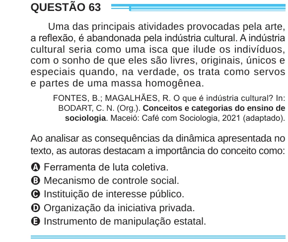

Texto extraído (pode conter ruído)

QUESTÃO 63  
Uma das principais atividades provocadas pela arte,  
a reflexão, é abandonada pela indústria cultural. A indústria  
cultural seria como uma isca que ilude os indivíduos,  
com o sonho de que eles são livres, originais, únicos e  
especiais quando, na verdade, os trata como servos  
e partes de uma massa homogênea.  
FONTES, B.; MAGALHÃES, R. O que é indústria cultural? In:  
BODART, C. N. (Org.). Conceitos e categorias do ensino de  
sociologia. Maceió: Café com Sociologia, 2021 (adaptado).  
Ao analisar as consequências da dinâmica apresentada no  
texto, as autoras destacam a importância do conceito como:  
A Ferramenta de luta coletiva.  
B Mecanismo de controle social.  
C Instituição de interesse público.  
D Organização da iniciativa privada.  
E Instrumento de manipulação estatal.

