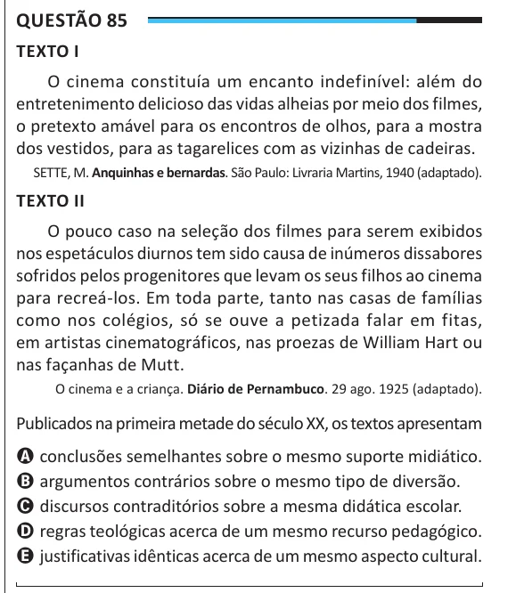

Texto extraído (pode conter ruído)

Questão 85  
TEXTO I  
O cinema constituía um encanto indefinível: além do  
entretenimento delicioso das vidas alheias por meio dos filmes,  
o pretexto amável para os encontros de olhos, para a mostra  
dos vestidos, para as tagarelices com as vizinhas de cadeiras.  
SETTE, M. Anquinhas e bernardas. São Paulo: Livraria Martins, 1940 (adaptado).  
TEXTO II  
O pouco caso na seleção dos filmes para serem exibidos  
nos espetáculos diurnos tem sido causa de inúmeros dissabores  
sofridos pelos progenitores que levam os seus filhos ao cinema  
para recreá-los. Em toda parte, tanto nas casas de famílias  
como nos colégios, só se ouve a petizada falar em fitas,  
em artistas cinematográficos, nas proezas de William Hart ou  
nas façanhas de Mutt.  
O cinema e a criança. Diário de Pernambuco. 29 ago. 1925 (adaptado).  
Publicados na primeira metade do século XX, os textos apresentam  
A conclusões semelhantes sobre o mesmo suporte midiático.  
B argumentos contrários sobre o mesmo tipo de diversão.  
C discursos contraditórios sobre a mesma didática escolar.  
D regras teológicas acerca de um mesmo recurso pedagógico.  
E justificativas idênticas acerca de um mesmo aspecto cultural.

