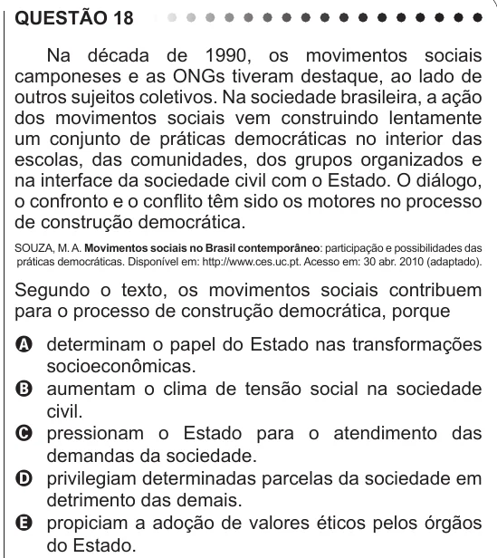

Texto extraído (pode conter ruído)

QUESTÃO 18  
Na década de 1990, os movimentos sociais  
camponeses e as ONGs tiveram destaque, ao lado de  
outros sujeitos coletivos. Na sociedade brasileira, a ação  
dos movimentos sociais vem construindo lentamente  
um conjunto de práticas democráticas no interior das  
escolas, das comunidades, dos grupos organizados e  
na interface da sociedade civil com o Estado. O diálogo,  
o confronto e o conflito têm sido os motores no processo  
de construção democrática.  
SOUZA, M. A. Movimentos sociais no Brasil contemporâneo: participação e possibilidades das  
práticas democráticas. Disponível em: http://www.ces.uc.pt. Acesso em: 30 abr. 2010 (adaptado).  
Segundo o texto, os movimentos sociais contribuem  
para o processo de construção democrática, porque  
A determinam o papel do Estado nas transformações  
socioeconômicas.  
B aumentam o clima de tensão social na sociedade  
civil.  
C pressionam o Estado para o atendimento das  
demandas da sociedade.  
D privilegiam determinadas parcelas da sociedade em  
detrimento das demais.  
E propiciam a adoção de valores éticos pelos órgãos  
do Estado.

