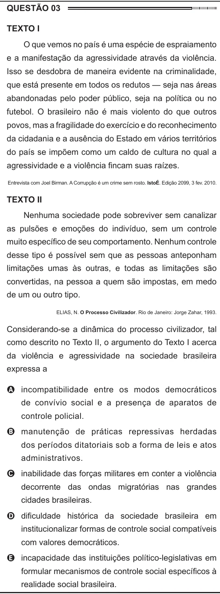

Texto extraído (pode conter ruído)

QUESTÃO 03  
Texto I  
O que vemos no país é uma espécie de espraiamento  
e a manifestação da agressividade através da violência.  
Isso se desdobra de maneira evidente na criminalidade,  
que está presente em todos os redutos — seja nas áreas  
abandonadas pelo poder público, seja na política ou no  
futebol. O brasileiro não é mais violento do que outros  
povos, mas a fragilidade do exercício e do reconhecimento  
da cidadania e a ausência do Estado em vários territórios  
do país se impõem como um caldo de cultura no qual a  
agressividade e a violência fincam suas raízes.  
Entrevista com Joel Birman. A Corrupção é um crime sem rosto. IstoÉ. Edição 2099, 3 fev. 2010.  
Texto II  
Nenhuma sociedade pode sobreviver sem canalizar  
as pulsões e emoções do indivíduo, sem um controle  
muito específico de seu comportamento. Nenhum controle  
desse tipo é possível sem que as pessoas anteponham  
limitações umas às outras, e todas as limitações são  
convertidas, na pessoa a quem são impostas, em medo  
de um ou outro tipo.  
ELIAS, N. O Processo Civilizador. Rio de Janeiro: Jorge Zahar, 1993.  
Considerando-se a dinâmica do processo civilizador, tal  
como descrito no Texto II, o argumento do Texto I acerca  
da violência e agressividade na sociedade brasileira  
expressa a  
A incompatibilidade entre os modos democráticos  
de convívio social e a presença de aparatos de  
controle policial.  
B manutenção de práticas repressivas herdadas  
dos períodos ditatoriais sob a forma de leis e atos  
administrativos.  
C inabilidade das forças militares em conter a violência  
decorrente das ondas migratórias nas grandes  
cidades brasileiras.  
D dificuldade histórica da sociedade brasileira em  
institucionalizar formas de controle social compatíveis  
com valores democráticos.  
E incapacidade das instituições político-legislativas em  
formular mecanismos de controle social específicos à  
realidade social brasileira.

