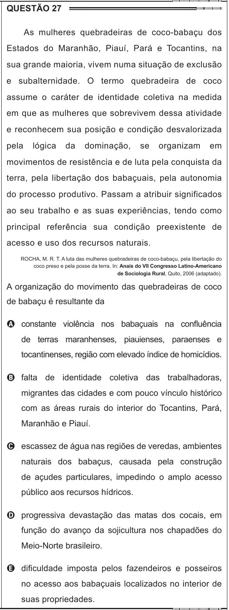

Texto extraído (pode conter ruído)

QUESTÃO 27  
As mulheres quebradeiras de coco-babaçu dos  
Estados do Maranhão, Piauí, Pará e Tocantins, na  
sua grande maioria, vivem numa situação de exclusão  
e subalternidade. O termo quebradeira de coco  
assume o caráter de identidade coletiva na medida  
em que as mulheres que sobrevivem dessa atividade  
e reconhecem sua posição e condição desvalorizada  
pela  
lógica  
da  
dominação,  
se  
organizam  
em  
movimentos de resistência e de luta pela conquista da  
terra, pela libertação dos babaçuais, pela autonomia  
do processo produtivo. Passam a atribuir significados  
ao seu trabalho e as suas experiências, tendo como  
principal referência sua condição preexistente de  
acesso e uso dos recursos naturais.  
ROCHA, M. R. T. A luta das mulheres quebradeiras de coco-babaçu, pela libertação do  
coco preso e pela posse da terra. In: Anais do VII Congresso Latino-Americano  
de Sociologia Rural, Quito, 2006 (adaptado).  
A organização do movimento das quebradeiras de coco  
de babaçu é resultante da  
A constante violência nos babaçuais na confluência  
de terras maranhenses, piauienses, paraenses e  
tocantinenses, região com elevado índice de homicídios.  
B falta de identidade coletiva das trabalhadoras,  
migrantes das cidades e com pouco vínculo histórico  
com as áreas rurais do interior do Tocantins, Pará,  
Maranhão e Piauí.  
C escassez de água nas regiões de veredas, ambientes  
naturais dos babaçus, causada pela construção  
de açudes particulares, impedindo o amplo acesso  
público aos recursos hídricos.  
D progressiva devastação das matas dos cocais, em  
função do avanço da sojicultura nos chapadões do  
Meio-Norte brasileiro.  
E dificuldade imposta pelos fazendeiros e posseiros  
no acesso aos babaçuais localizados no interior de  
suas propriedades.

