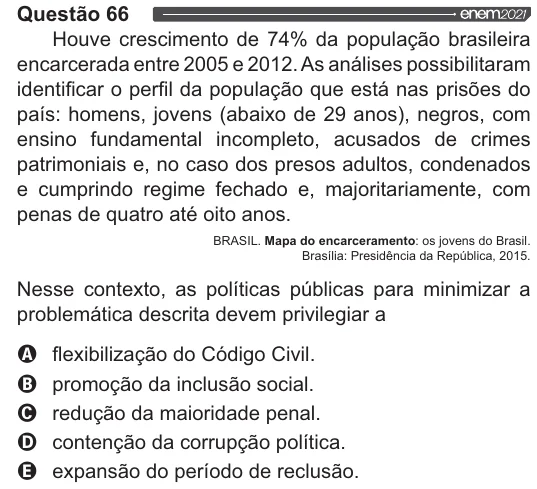

Texto extraído (pode conter ruído)

Questão 66  
Houve crescimento de 74% da população brasileira  
encarcerada entre 2005 e 2012. As análises possibilitaram  
identificar o perfil da população que está nas prisões do  
país: homens, jovens (abaixo de 29 anos), negros, com  
ensino fundamental incompleto, acusados de crimes  
patrimoniais e, no caso dos presos adultos, condenados  
e cumprindo regime fechado e, majoritariamente, com  
penas de quatro até oito anos.  
BRASIL. Mapa do encarceramento: os jovens do Brasil.  
Brasília: Presidência da República, 2015.  
Nesse contexto, as políticas públicas para minimizar a  
problemática descrita devem privilegiar a  
O flexibilização do Código Civil.  
O promoção da inclusão social.  
O redução da maioridade penal.  
O contenção da corrupção política.  
OQ expansão do período de reclusão.

