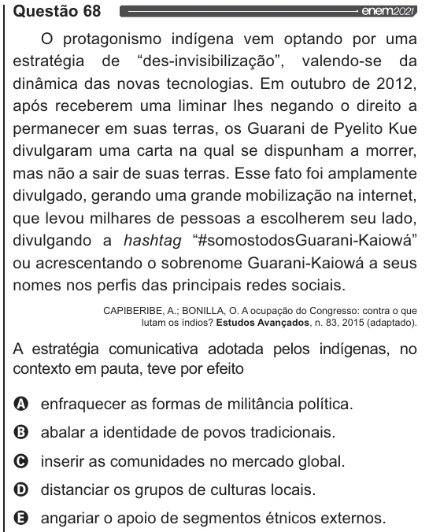

Texto extraído (pode conter ruído)

Questão 68  
O protagonismo indígena vem optando por uma  
estratégia de “des-invisibilzação”, valendo-se da  
dinâmica das novas tecnologias. Em outubro de 2012,  
após receberem uma liminar lhes negando o direito a  
permanecer em suas terras, os Guarani de Pyelito Kue  
divulgaram uma carta na qual se dispunham a morrer,  
mas não a sair de suas terras. Esse fato foi amplamente  
divulgado, gerando uma grande mobilização na internet,  
que levou milhares de pessoas a escolherem seu lado,  
divulgando a hashtag “FsomostodosGuarani-Kaiowá”  
ou acrescentando o sobrenome Guarani-Kaiowá a seus  
nomes nos perfis das principais redes sociais.  
CAPIBERIBE, A.; BONILLA, O. A ocupação do Congresso: contra o que  
lutam os índios? Estudos Avançados, n. 83, 2015 (adaptado).  
A estratégia comunicativa adotada pelos indígenas, no  
contexto em pauta, teve por efeito  
Q enfraquecer as formas de militância política.  
O abalar a identidade de povos tradicionais.  
O inserir as comunidades no mercado global.  
O distanciar os grupos de culturas locais.  
& angariar o apoio de segmentos étnicos externos.

