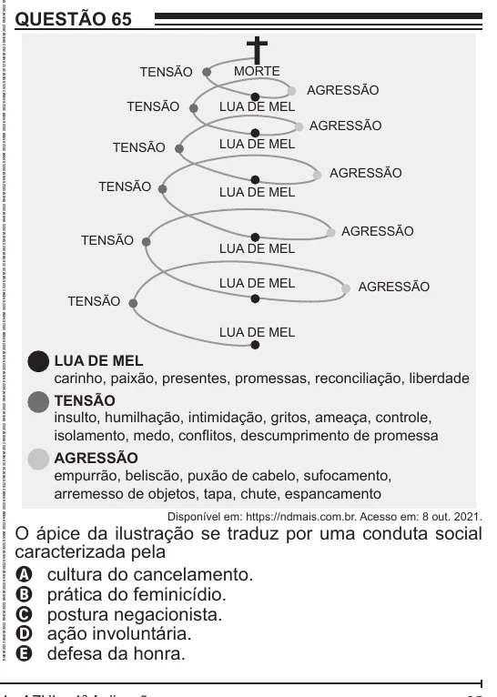

Texto extraído (pode conter ruído)

QUESTÃO 65  
TENSÃO  
MORTE  
AGRESSÃO  
TENSÃO  
LUA DE MEL  
AGRESSÃO  
LUA DE MEL  
TENSÃO  
AGRESSÃO  
TENSÃO  
LUA DE MEL  
AGRESSÃO  
TENSÃO  
LUA DE MEL  
LUA DE MEL  
AGRESSÃO  
TENSÃO  
LUA DE MEL  
LUA DE MEL  
carinho, paixão, presentes, promessas, reconciliação, liberdade  
TENSÃO  
insulto, humilhação, intimidação, gritos, ameaça, controle,  
isolamento, medo, conflitos, descumprimento de promessa  
AGRESSÃO  
empurrão, beliscão, puxão de cabelo, sufocamento,  
arremesso de objetos, tapa, chute, espancamento  
Disponível em: https://ndmais.com.br. Acesso em: 8 out. 2021.  
O ápice da ilustração se traduz por uma conduta social  
caracterizada pela  
A cultura do cancelamento.  
B prática do feminicídio.  
C postura negacionista.  
D ação involuntária.  
E defesa da honra.

