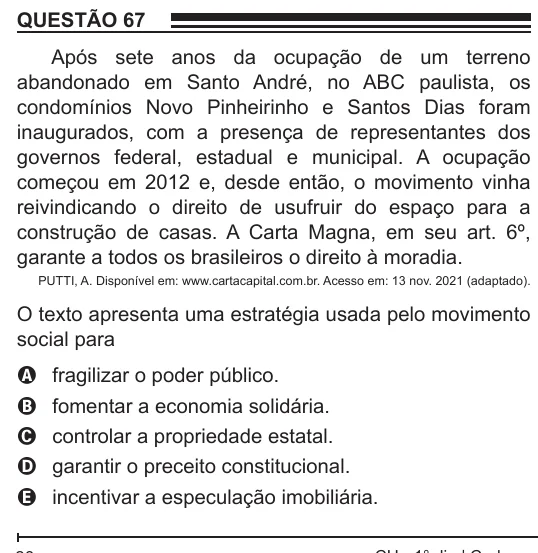

Texto extraído (pode conter ruído)

QUESTÃO 67  
Após sete anos da ocupação de um terreno  
abandonado em Santo André, no ABC paulista, os  
condomínios Novo Pinheirinho e Santos Dias foram  
inaugurados, com a presença de representantes dos  
governos federal, estadual e municipal. A ocupação  
começou em 2012 e, desde então, o movimento vinha  
reivindicando o direito de usufruir do espaço para a  
construção de casas. A Carta Magna, em seu art. 6º,  
garante a todos os brasileiros o direito à moradia.  
PUTTI, A. Disponível em: www.cartacapital.com.br. Acesso em: 13 nov. 2021 (adaptado).  
O texto apresenta uma estratégia usada pelo movimento  
social para  
fragilizar o poder público.  
A  
fomentar a economia solidária.  
B  
controlar a propriedade estatal.  
C  
garantir o preceito constitucional.  
D  
E  
incentivar a especulação imobiliária.

