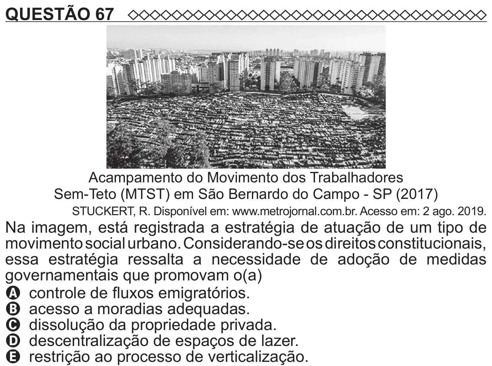

Texto extraído (pode conter ruído)

QUESTÃO 67  
Acampamento do Movimento dos Trabalhadores  
Sem-Teto (MTST) em São Bernardo do Campo - SP (2017)  
STUCKERT, R. Disponível em: www.metrojornal.com.br. Acesso em: 2 ago. 2019.  
Na imagem, está registrada a estratégia de atuação de um tipo de  
movimento social urbano. Considerando-se os direitos constitucionais,  
essa estratégia ressalta a necessidade de adoção de medidas  
governamentais que promovam o(a)  
A controle de fluxos emigratórios.  
B acesso a moradias adequadas.  
C dissolução da propriedade privada.  
D descentralização de espaços de lazer.

