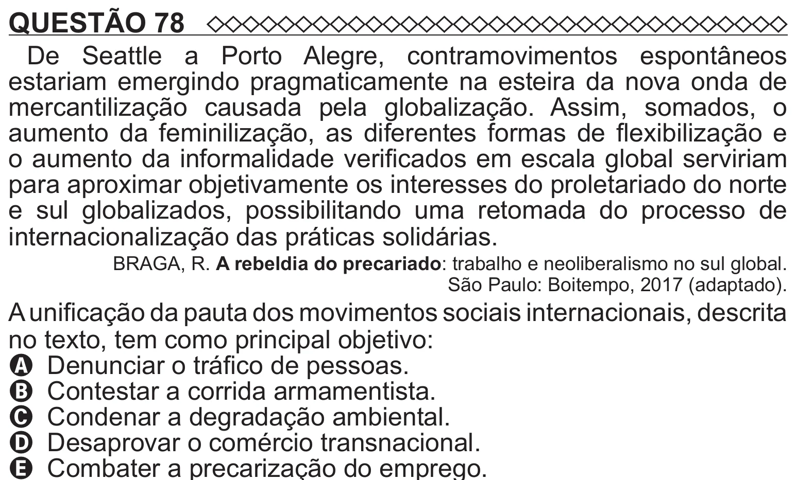

Texto extraído (pode conter ruído)

QUESTÃO 78  
De Seattle a Porto Alegre, contramovimentos espontâneos  
estariam emergindo pragmaticamente na esteira da nova onda de  
mercantilização causada pela globalização. Assim, somados, o  
aumento da feminilização, as diferentes formas de flexibilização e  
o aumento da informalidade verificados em escala global serviriam  
para aproximar objetivamente os interesses do proletariado do norte  
e sul globalizados, possibilitando uma retomada do processo de  
internacionalização das práticas solidárias.  
BRAGA, R. A rebeldia do precariado: trabalho e neoliberalismo no sul global.  
São Paulo: Boitempo, 2017 (adaptado).  
A unificação da pauta dos movimentos sociais internacionais, descrita  
no texto, tem como principal objetivo:  
A Denunciar o tráfico de pessoas.  
B Contestar a corrida armamentista.  
C Condenar a degradação ambiental.  
D Desaprovar o comércio transnacional.

