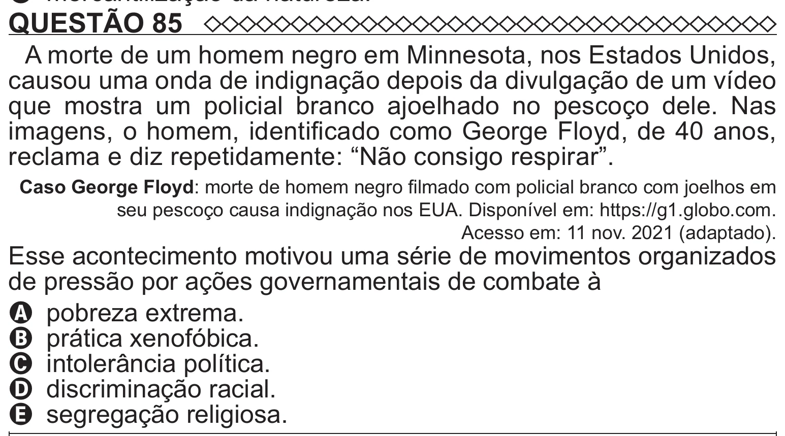

Texto extraído (pode conter ruído)

QUESTÃO 85  
A morte de um homem negro em Minnesota, nos Estados Unidos,  
causou uma onda de indignação depois da divulgação de um vídeo  
que mostra um policial branco ajoelhado no pescoço dele. Nas  
imagens, o homem, identificado como George Floyd, de 40 anos,  
reclama e diz repetidamente: “Não consigo respirar”.  
Caso George Floyd: morte de homem negro filmado com policial branco com joelhos em  
seu pescoço causa indignação nos EUA. Disponível em: https://g1.globo.com.  
Acesso em: 11 nov. 2021 (adaptado).  
Esse acontecimento motivou uma série de movimentos organizados  
de pressão por ações governamentais de combate à  
A pobreza extrema.  
B prática xenofóbica.  
C intolerância política.  
D discriminação racial.  
E segregação religiosa.

