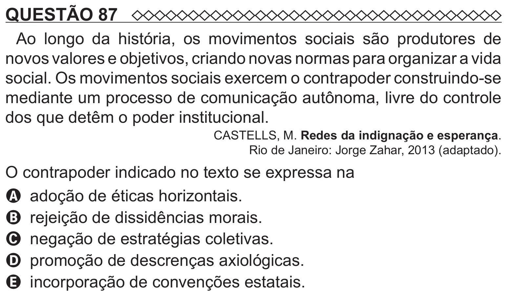

Texto extraído (pode conter ruído)

QUESTÃO 87  
Ao longo da história, os movimentos sociais são produtores de  
novos valores e objetivos, criando novas normas para organizar a vida  
social. Os movimentos sociais exercem o contrapoder construindo-se  
mediante um processo de comunicação autônoma, livre do controle  
dos que detêm o poder institucional.  
CASTELLS, M. Redes da indignação e esperança.  
Rio de Janeiro: Jorge Zahar, 2013 (adaptado).  
O contrapoder indicado no texto se expressa na  
A adoção de éticas horizontais.  
B rejeição de dissidências morais.  
C negação de estratégias coletivas.  
D promoção de descrenças axiológicas.  
E incorporação de convenções estatais.

