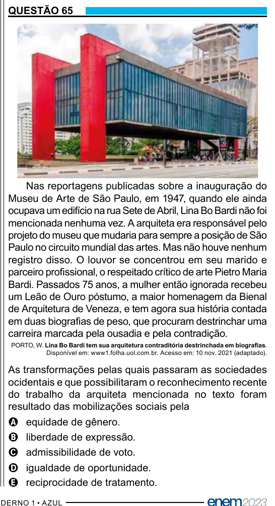

Texto extraído (pode conter ruído)

QUESTÃO 65  
Nas reportagens publicadas sobre a inauguração do  
Museu de Arte de São Paulo, em 1947, quando ele ainda  
ocupava um edifício na rua Sete de Abril, Lina Bo Bardi não foi  
mencionada nenhuma vez. A arquiteta era responsável pelo  
projeto do museu que mudaria para sempre a posição de São  
Paulo no circuito mundial das artes. Mas não houve nenhum  
registro disso. O louvor se concentrou em seu marido e  
parceiro profissional, o respeitado crítico de arte Pietro Maria  
Bardi. Passados 75 anos, a mulher então ignorada recebeu  
um Leão de Ouro póstumo, a maior homenagem da Bienal  
de Arquitetura de Veneza, e tem agora sua história contada  
em duas biografias de peso, que procuram destrinchar uma  
carreira marcada pela ousadia e pela contradição.  
PORTO, W. Lina Bo Bardi tem sua arquitetura contraditória destrinchada em biografias.  
Disponível em: www1.folha.uol.com.br. Acesso em: 10 nov. 2021 (adaptado).  
As transformações pelas quais passaram as sociedades  
ocidentais e que possibilitaram o reconhecimento recente  
do trabalho da arquiteta mencionada no texto foram  
resultado das mobilizações sociais pela  
A equidade de gênero.  
B liberdade de expressão.  
C admissibilidade de voto.  
D igualdade de oportunidade.  
E reciprocidade de tratamento.

