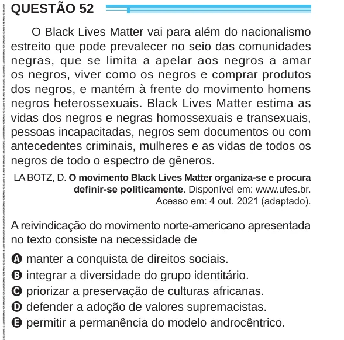

Texto extraído (pode conter ruído)

QUESTÃO 52  
O Black Lives Matter vai para além do nacionalismo  
estreito que pode prevalecer no seio das comunidades  
negras, que se limita a apelar aos negros a amar  
os negros, viver como os negros e comprar produtos  
dos negros, e mantém à frente do movimento homens  
negros heterossexuais. Black Lives Matter estima as  
vidas dos negros e negras homossexuais e transexuais,  
pessoas incapacitadas, negros sem documentos ou com  
antecedentes criminais, mulheres e as vidas de todos os  
negros de todo o espectro de gêneros.  
LA BOTZ, D. O movimento Black Lives Matter organiza-se e procura  
definir-se politicamente. Disponível em: www.ufes.br.  
Acesso em: 4 out. 2021 (adaptado).  
A reivindicação do movimento norte-americano apresentada  
no texto consiste na necessidade de  
A manter a conquista de direitos sociais.  
B integrar a diversidade do grupo identitário.  
C priorizar a preservação de culturas africanas.  
D defender a adoção de valores supremacistas.  
E permitir a permanência do modelo androcêntrico.

