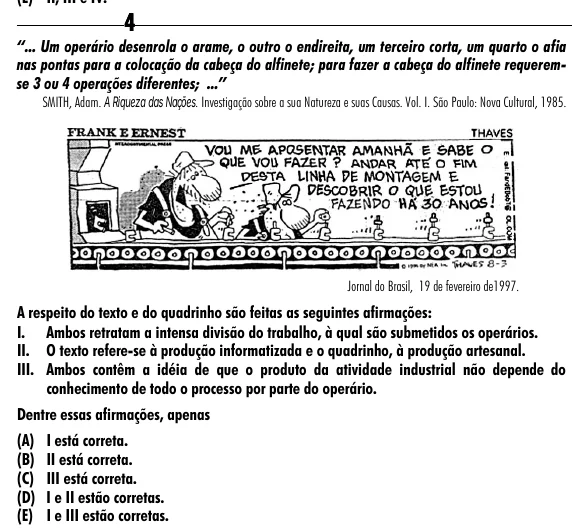

Texto extraído (pode conter ruído)

4  
“... Um operário desenrola o arame, o outro o endireita, um terceiro corta, um quarto o afia  
nas pontas para a colocação da cabeça do alfinete; para fazer a cabeça do alfinete requerem-  
se 3 ou 4 operações diferentes; ...”  
SMITH, Adam. A Riqueza das Nações. Investigação sobre a sua Natureza e suas Causas. Vol. I. São Paulo: Nova Cultural, 1985.  
Jornal do Brasil, 19 de fevereiro de1997.  
A respeito do texto e do quadrinho são feitas as seguintes afirmações:  
I. Ambos retratam a intensa divisão do trabalho, à qual são submetidos os operários.  
II. O texto refere-se à produção informatizada e o quadrinho, à produção artesanal.  
III. Ambos contêm a idéia de que o produto da atividade industrial não depende do  
conhecimento de todo o processo por parte do operário.  
Dentre essas afirmações, apenas  
(A) I está correta.  
(B) II está correta.  
(C) III está correta.  
(D) I e II estão corretas.  
(E) I e III estão corretas.

