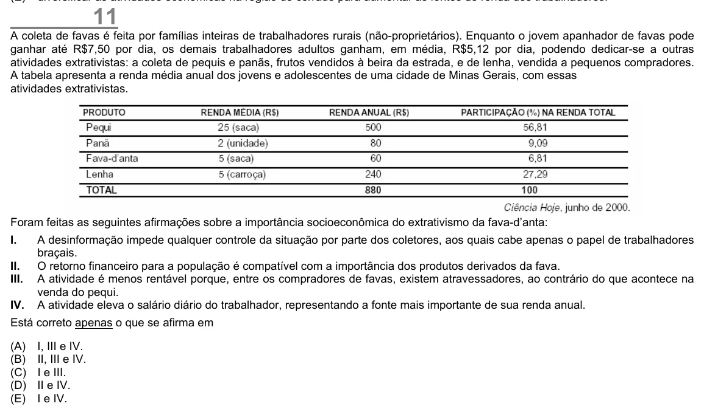

Texto extraído (pode conter ruído)

11  
A coleta de favas é feita por famílias inteiras de trabalhadores rurais (não-proprietários). Enquanto o jovem apanhador de favas pode  
ganhar até R$7,50 por dia, os demais trabalhadores adultos ganham, em média, R$5,12 por dia, podendo dedicar-se a outras  
atividades extrativistas: a coleta de pequis e panãs, frutos vendidos à beira da estrada, e de lenha, vendida a pequenos compradores.  
A tabela apresenta a renda média anual dos jovens e adolescentes de uma cidade de Minas Gerais, com essas  
atividades extrativistas.  
Foram feitas as seguintes afirmações sobre a importância socioeconômica do extrativismo da fava-d’anta:  
I.  
A desinformação impede qualquer controle da situação por parte dos coletores, aos quais cabe apenas o papel de trabalhadores  
braçais.  
II.  
O retorno financeiro para a população é compatível com a importância dos produtos derivados da fava.  
III.  
A atividade é menos rentável porque, entre os compradores de favas, existem atravessadores, ao contrário do que acontece na  
venda do pequi.  
IV.  
A atividade eleva o salário diário do trabalhador, representando a fonte mais importante de sua renda anual.  
Está correto apenas o que se afirma em  
(A)  
I, III e IV.  
(B)  
II, III e IV.  
(C)  
I e III.  
(D)  
II e IV.  
(E)  
I e IV.

