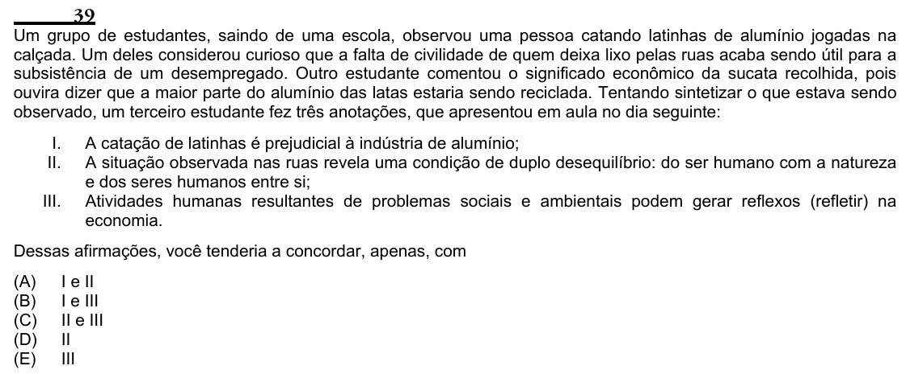

Texto extraído (pode conter ruído)

39  
Um grupo de estudantes, saindo de uma escola, observou uma pessoa catando latinhas de alumínio jogadas na  
calçada. Um deles considerou curioso que a falta de civilidade de quem deixa lixo pelas ruas acaba sendo útil para a  
subsistência de um desempregado. Outro estudante comentou o significado econômico da sucata recolhida, pois  
ouvira dizer que a maior parte do alumínio das latas estaria sendo reciclada. Tentando sintetizar o que estava sendo  
observado, um terceiro estudante fez três anotações, que apresentou em aula no dia seguinte:  
I.  
A catação de latinhas é prejudicial à indústria de alumínio;  
II.  
A situação observada nas ruas revela uma condição de duplo desequilíbrio: do ser humano com a natureza  
e dos seres humanos entre si;  
III.  
Atividades humanas resultantes de problemas sociais e ambientais podem gerar reflexos (refletir) na  
economia.  
Dessas afirmações, você tenderia a concordar, apenas, com  
(A)  
I e II  
(B)  
I e III  
(C)  
II e III  
(D)  
II  
(E)  
III

