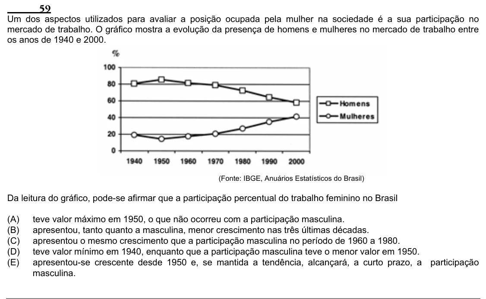

Texto extraído (pode conter ruído)

59  
Um dos aspectos utilizados para avaliar a posição ocupada pela mulher na sociedade é a sua participação no  
mercado de trabalho. O gráfico mostra a evolução da presença de homens e mulheres no mercado de trabalho entre  
os anos de 1940 e 2000.  
(Fonte: IBGE, Anuários Estatísticos do Brasil)  
Da leitura do gráfico, pode-se afirmar que a participação percentual do trabalho feminino no Brasil  
(A)  
teve valor máximo em 1950, o que não ocorreu com a participação masculina.  
(B)  
apresentou, tanto quanto a masculina, menor crescimento nas três últimas décadas.  
(C)  
apresentou o mesmo crescimento que a participação masculina no período de 1960 a 1980.  
(D)  
teve valor mínimo em 1940, enquanto que a participação masculina teve o menor valor em 1950.  
(E)  
apresentou-se crescente desde 1950 e, se mantida a tendência, alcançará, a curto prazo, a participação  
masculina.

