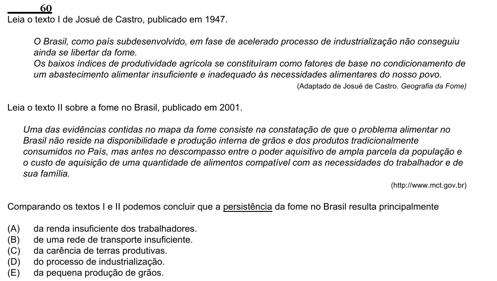

Texto extraído (pode conter ruído)

60  
Leia o texto I de Josué de Castro, publicado em 1947.  
O Brasil, como país subdesenvolvido, em fase de acelerado processo de industrialização não conseguiu  
ainda se libertar da fome.  
Os baixos índices de produtividade agrícola se constituíram como fatores de base no condicionamento de  
um abastecimento alimentar insuficiente e inadequado às necessidades alimentares do nosso povo.  
(Adaptado de Josué de Castro. Geografia da Fome)  
Leia o texto II sobre a fome no Brasil, publicado em 2001.  
Uma das evidências contidas no mapa da fome consiste na constatação de que o problema alimentar no  
Brasil não reside na disponibilidade e produção interna de grãos e dos produtos tradicionalmente  
consumidos no País, mas antes no descompasso entre o poder aquisitivo de ampla parcela da população e  
o custo de aquisição de uma quantidade de alimentos compatível com as necessidades do trabalhador e de  
sua família.  
(http://www.mct.gov.br)  
Comparando os textos I e II podemos concluir que a persistência da fome no Brasil resulta principalmente  
(A)  
da renda insuficiente dos trabalhadores.  
(B)  
de uma rede de transporte insuficiente.  
(C)  
da carência de terras produtivas.  
(D)  
do processo de industrialização.  
(E)  
da pequena produção de grãos.

