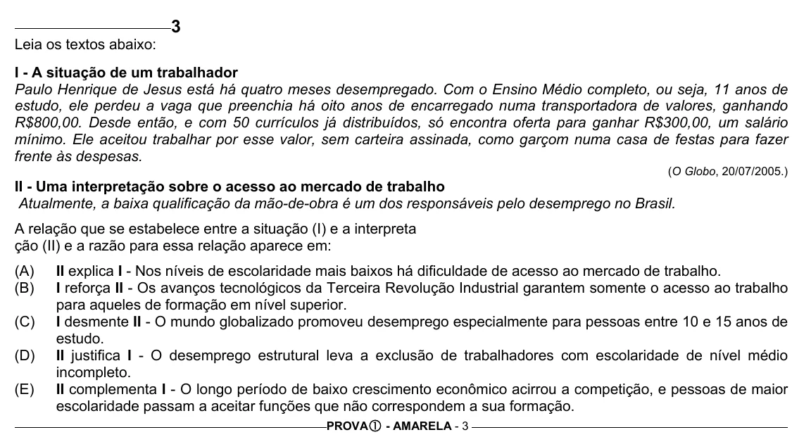

Texto extraído (pode conter ruído)

3  
Leia os textos abaixo:  
I - A situação de um trabalhador  
Paulo Henrique de Jesus está há quatro meses desempregado. Com o Ensino Médio completo, ou seja, 11 anos de  
estudo, ele perdeu a vaga que preenchia há oito anos de encarregado numa transportadora de valores, ganhando  
R$800,00. Desde então, e com 50 currículos já distribuídos, só encontra oferta para ganhar R$300,00, um salário  
mínimo. Ele aceitou trabalhar por esse valor, sem carteira assinada, como garçom numa casa de festas para fazer  
frente às despesas.  
(O Globo, 20/07/2005.)  
II - Uma interpretação sobre o acesso ao mercado de trabalho  
Atualmente, a baixa qualificação da mão-de-obra é um dos responsáveis pelo desemprego no Brasil.  
A relação que se estabelece entre a situação (I) e a interpreta  
ção (II) e a razão para essa relação aparece em:  
(A)  
II explica I - Nos níveis de escolaridade mais baixos há dificuldade de acesso ao mercado de trabalho.  
(B)  
I reforça II - Os avanços tecnológicos da Terceira Revolução Industrial garantem somente o acesso ao trabalho  
para aqueles de formação em nível superior.  
(C)  
I desmente II - O mundo globalizado promoveu desemprego especialmente para pessoas entre 10 e 15 anos de  
estudo.  
(D)  
II justifica I - O desemprego estrutural leva a exclusão de trabalhadores com escolaridade de nível médio  
incompleto.  
(E)  
II complementa I - O longo período de baixo crescimento econômico acirrou a competição, e pessoas de maior  
escolaridade passam a aceitar funções que não correspondem a sua formação.  
PROVA c - AMARELA - 3

