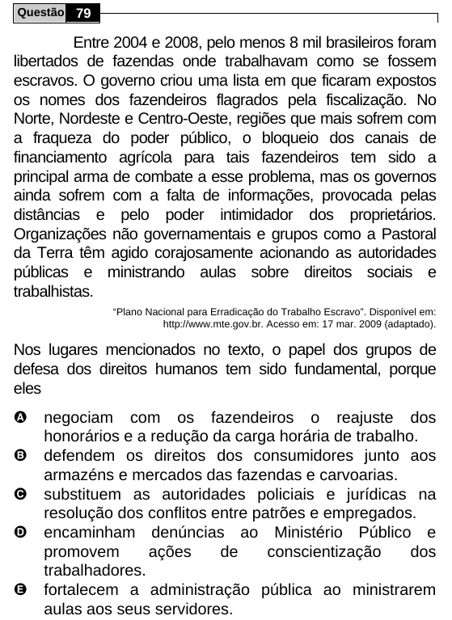

Texto extraído (pode conter ruído)

Questão 79  
Entre 2004 e 2008, pelo menos 8 mil brasileiros foram  
libertados de fazendas onde trabalhavam como se fossem  
escravos. O governo criou uma lista em que ficaram expostos  
os nomes dos fazendeiros flagrados pela fiscalização. No  
Norte, Nordeste e Centro-Oeste, regiões que mais sofrem com  
a fraqueza do poder público, o bloqueio dos canais de  
financiamento agrícola para tais fazendeiros tem sido a  
principal arma de combate a esse problema, mas os governos  
ainda sofrem com a falta de informações, provocada pelas  
distâncias e pelo poder intimidador dos proprietários.  
Organizações não governamentais e grupos como a Pastoral  
da Terra têm agido corajosamente acionando as autoridades  
públicas e ministrando aulas sobre direitos sociais e  
trabalhistas.  
“Plano Nacional para Erradicação do Trabalho Escravo”. Disponível em:  
http://www.mte.gov.br. Acesso em: 17 mar. 2009 (adaptado).  
Nos lugares mencionados no texto, o papel dos grupos de  
defesa dos direitos humanos tem sido fundamental, porque  
eles  
A  
negociam com os fazendeiros o reajuste dos  
honorários e a redução da carga horária de trabalho.  
B  
defendem os direitos dos consumidores junto aos  
armazéns e mercados das fazendas e carvoarias.  
C  
substituem as autoridades policiais e jurídicas na  
resolução dos conflitos entre patrões e empregados.  
D  
encaminham denúncias ao Ministério Público e  
promovem  
ações  
de  
conscientização  
dos  
trabalhadores.  
E  
fortalecem a administração pública ao ministrarem  
aulas aos seus servidores.

