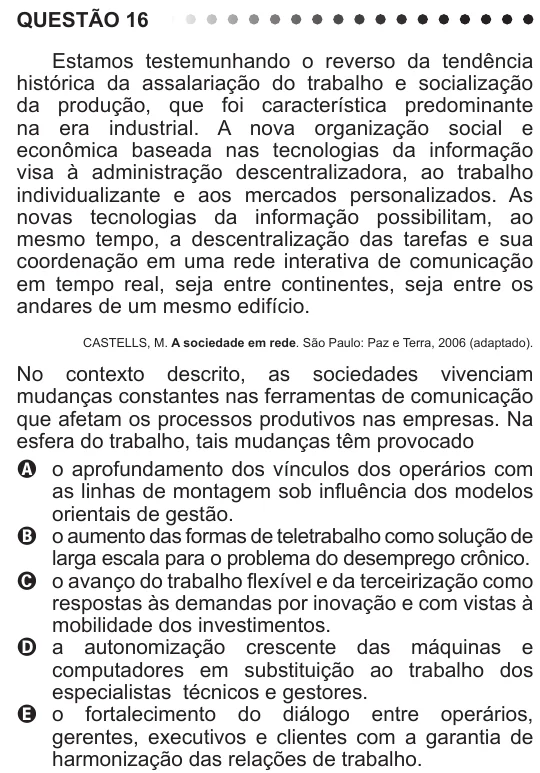

Texto extraído (pode conter ruído)

QUESTÃO 16  
Estamos testemunhando o reverso da tendência  
histórica da assalariação do trabalho e socialização  
da produção, que foi característica predominante  
na era industrial. A nova organização social e  
econômica baseada nas tecnologias da informação  
visa à administração descentralizadora, ao trabalho  
individualizante e aos mercados personalizados. As  
novas tecnologias da informação possibilitam, ao  
mesmo tempo, a descentralização das tarefas e sua  
coordenação em uma rede interativa de comunicação  
em tempo real, seja entre continentes, seja entre os  
andares de um mesmo edifício.  
CASTELLS, M. A sociedade em rede. São Paulo: Paz e Terra, 2006 (adaptado).  
No contexto descrito, as sociedades vivenciam  
mudanças constantes nas ferramentas de comunicação  
que afetam os processos produtivos nas empresas. Na  
esfera do trabalho, tais mudanças têm provocado  
A o aprofundamento dos vínculos dos operários com  
as linhas de montagem sob influência dos modelos  
orientais de gestão.  
B o aumento das formas de teletrabalho como solução de  
larga escala para o problema do desemprego crônico.  
C o avanço do trabalho flexível e da terceirização como  
respostas às demandas por inovação e com vistas à  
mobilidade dos investimentos.  
D a autonomização crescente das máquinas e  
computadores em substituição ao trabalho dos  
especialistas técnicos e gestores.  
E o fortalecimento do diálogo entre operários,  
gerentes, executivos e clientes com a garantia de  
harmonização das relações de trabalho.

