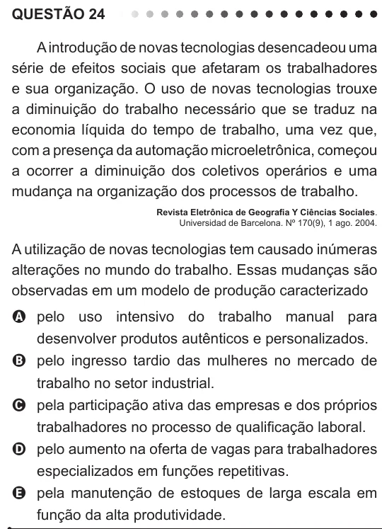

Texto extraído (pode conter ruído)

QUESTÃO 24  
A introdução de novas tecnologias desencadeou uma  
série de efeitos sociais que afetaram os trabalhadores  
e sua organização. O uso de novas tecnologias trouxe  
a diminuição do trabalho necessário que se traduz na  
economia líquida do tempo de trabalho, uma vez que,  
com a presença da automação microeletrônica, começou  
a ocorrer a diminuição dos coletivos operários e uma  
mudança na organização dos processos de trabalho.  
Revista Eletrônica de Geografia Y Ciências Sociales.  
Universidad de Barcelona. Nº 170(9), 1 ago. 2004.  
A utilização de novas tecnologias tem causado inúmeras  
alterações no mundo do trabalho. Essas mudanças são  
observadas em um modelo de produção caracterizado  
A pelo uso intensivo do trabalho manual para  
desenvolver produtos autênticos e personalizados.  
B pelo ingresso tardio das mulheres no mercado de  
trabalho no setor industrial.  
C pela participação ativa das empresas e dos próprios  
trabalhadores no processo de qualificação laboral.  
D pelo aumento na oferta de vagas para trabalhadores  
especializados em funções repetitivas.  
E pela manutenção de estoques de larga escala em  
função da alta produtividade.

