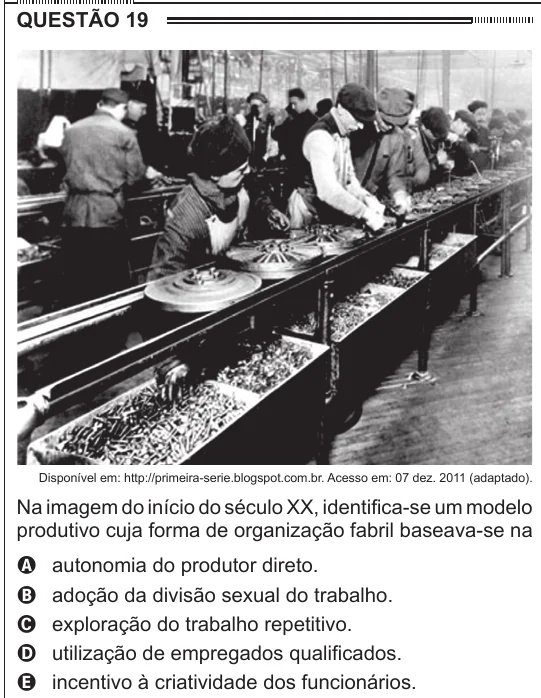

Texto extraído (pode conter ruído)

QUESTÃO 19  
Disponível em: http://primeira-serie.blogspot.com.br. Acesso em: 07 dez. 2011 (adaptado).  
Na imagem do início do século XX, identifica-se um modelo  
produtivo cuja forma de organização fabril baseava-se na  
autonomia do produtor direto.  
A  
adoção da divisão sexual do trabalho.  
B  
C  
exploração do trabalho repetitivo.  
utilização de empregados qualificados.  
D  
incentivo à criatividade dos funcionários.  
E

