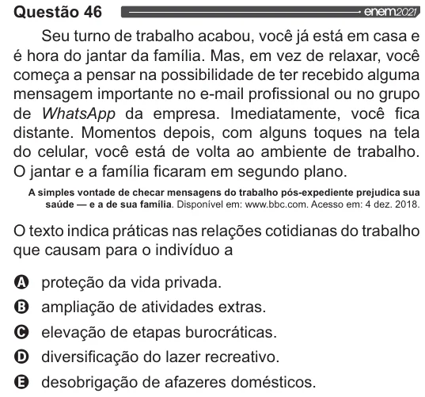

Texto extraído (pode conter ruído)

Questão 46  
enem202,  
Seu turno de trabalho acabou, você já está em casa e  
é hora do jantar da família. Mas, em vez de relaxar, você  
começa a pensar na possibilidade de ter recebido alguma  
mensagem importante no e-mail profissional ou no grupo  
de WhatsApp da empresa. Imediatamente, você fica  
distante. Momentos depois, com alguns toques na tela  
do celular, você está de volta ao ambiente de trabalho.  
O jantar e a família ficaram em segundo plano.  
A simples vontade de checar mensagens do trabalho pós-expediente prejudica sua  
saúde — e a de sua família. Disponível em: www.bbc.com. Acesso em: 4 dez. 2018.  
O texto indica práticas nas relações cotidianas do trabalho  
que causam para o indivíduo a  
VOOS  
proteção da vida privada.  
ampliação de atividades extras.  
elevação de etapas burocráticas.  
diversificação do lazer recreativo.  
desobrigação de afazeres domésticos.

