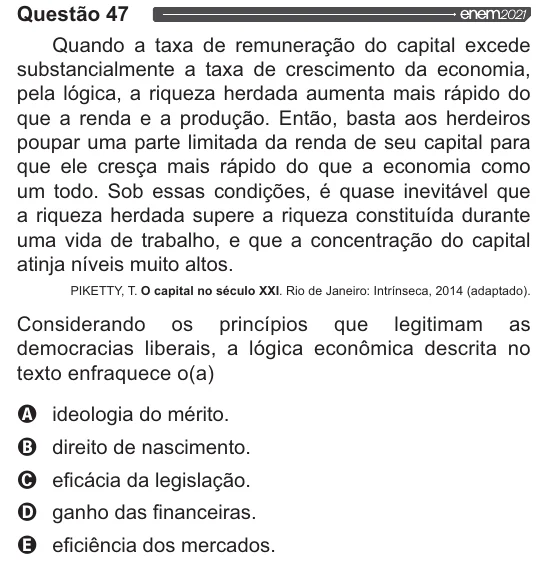

Texto extraído (pode conter ruído)

Questão 47  
Quando a taxa de remuneração do capital excede  
substancialmente a taxa de crescimento da economia,  
pela lógica, a riqueza herdada aumenta mais rápido do  
que a renda e a produção. Então, basta aos herdeiros  
poupar uma parte limitada da renda de seu capital para  
que ele cresça mais rápido do que a economia como  
um todo. Sob essas condições, é quase inevitável que  
a riqueza herdada supere a riqueza constituída durante  
uma vida de trabalho, e que a concentração do capital  
atinja níveis muito altos.  
PIKETTY, T. O capital no século XXI. Rio de Janeiro: Intrínseca, 2014 (adaptado).  
Considerando os princípios que legitimam as  
democracias liberais, a lógica econômica descrita no  
texto enfraquece o(a)  
VOVOO  
ideologia do mérito.  
direito de nascimento.  
eficácia da legislação.  
ganho das financeiras.  
eficiência dos mercados.

