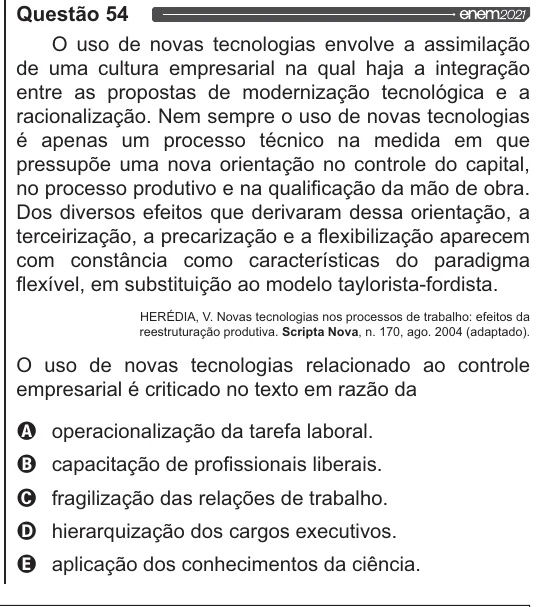

Texto extraído (pode conter ruído)

Questão 54  
O uso de novas tecnologias envolve a assimilação  
de uma cultura empresarial na qual haja a integração  
entre as propostas de modernização tecnológica e a  
racionalização. Nem sempre o uso de novas tecnologias  
é apenas um processo técnico na medida em que  
pressupõe uma nova orientação no controle do capital,  
no processo produtivo e na qualificação da mão de obra.  
Dos diversos efeitos que derivaram dessa orientação, a  
terceirização, a precarização e a flexibilização aparecem  
com constância como características do paradigma  
flexível, em substituição ao modelo taylorista-fordista.  
HERÉDIA, V. Novas tecnologias nos processos de trabalho: efeitos da  
reestruturação produtiva. Scripta Nova, n. 170, ago. 2004 (adaptado).  
O uso de novas tecnologias relacionado ao controle  
empresarial é criticado no texto em razão da  
Q operacionalização da tarefa laboral.  
(6)  
capacitação de profissionais liberais.  
(C)  
fragilização das relações de trabalho.  
D)  
hierarquização dos cargos executivos.  
LE)  
aplicação dos conhecimentos da ciência.

