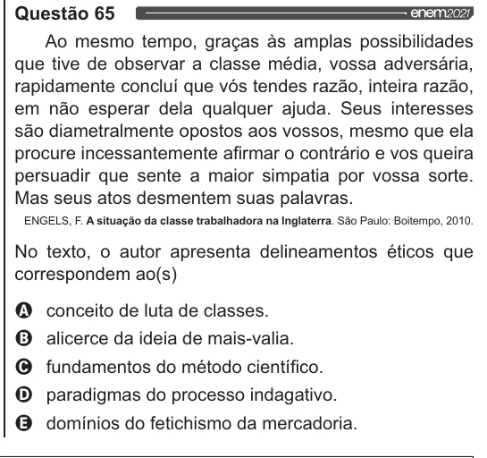

Texto extraído (pode conter ruído)

Questão 65  
Ao mesmo tempo, graças às amplas possibilidades  
que tive de observar a classe média, vossa adversária,  
rapidamente concluí que vós tendes razão, inteira razão,  
em não esperar dela qualquer ajuda. Seus interesses  
são diametralmente opostos aos vossos, mesmo que ela  
procure incessantemente afirmar o contrário e vos queira  
persuadir que sente a maior simpatia por vossa sorte.  
Mas seus atos desmentem suas palavras.  
ENGELS, F. A situação da classe trabalhadora na Inglaterra. São Paulo: Boitempo, 2010.  
No texto, o autor apresenta delineamentos éticos que  
correspondem ao(s)  
conceito de luta de classes.  
alicerce da ideia de mais-valia.  
fundamentos do método científico.  
paradigmas do processo indagativo.  
domínios do fetichismo da mercadoria.

