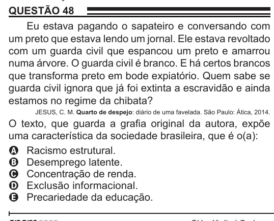

Texto extraído (pode conter ruído)

QUESTÃO 48  
Eu estava pagando o sapateiro e conversando com  
um preto que estava lendo um jornal. Ele estava revoltado  
com um guarda civil que espancou um preto e amarrou  
numa árvore. O guarda civil é branco. E há certos brancos  
que transforma preto em bode expiatório. Quem sabe se  
guarda civil ignora que já foi extinta a escravidão e ainda  
estamos no regime da chibata?  
JESUS, C. M. Quarto de despejo: diário de uma favelada. São Paulo: Ática, 2014.  
O texto, que guarda a grafia original da autora, expõe  
uma característica da sociedade brasileira, que é o(a):  
A Racismo estrutural.  
B Desemprego latente.  
C Concentração de renda.  
D Exclusão informacional.  
E Precariedade da educação.

