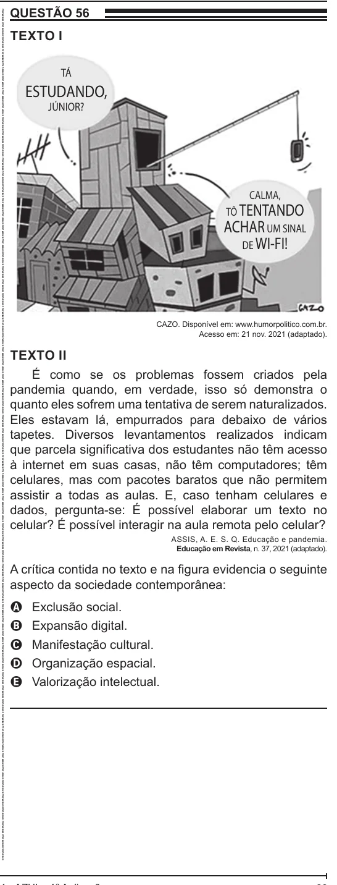

Texto extraído (pode conter ruído)

QUESTÃO 56  
ENEM 2022 ENEM 2022 ENEM 2022 ENEM 2022 ENEM 2022 ENEM 2022 ENEM 2022 ENEM 2022 ENEM 2022 ENEM 2022 ENEM 2022 ENEM 2022 ENEM 2022 ENEM 2022 ENEM 2022 ENEM 2022 ENEM 2022 ENEM 2022 ENEM 2022 ENEM 2022 ENEM 2022 ENEM 2022 ENEM 2022 ENEM 2022 ENEM 2022 ENEM 2022 ENEM 2022 ENEM 2022 ENEM 2022 ENEM 2022 ENEM 2022 ENEM 2022 ENEM 2022 ENEM 2022 ENEM 2022 ENEM 2022 ENEM 2022 ENEM 2022 ENEM 2022 ENEM 2022 ENEM 2022 ENEM 2022 ENEM 2022 ENEM 2022 ENEM 2022 ENEM 2022 ENEM 2022 ENEM 2022 ENEM 2022 ENEM 2022 ENEM 2022 ENEM 2022 ENEM 2022 ENEM 2022 ENEM 2022 ENEM 2022 ENEM 2022 ENEM 2022 ENEM 2022 ENEM 2022 ENEM 2022 ENEM 2022 ENEM 2022  
TEXTO I  
TÁ  
ESTUDANDO,  
JÚNIOR?  
CALMA,  
TÔ TENTANDO  
ACHAR UM SINAL  
DE WI-FI!  
CAZO. Disponível em: www.humorpolitico.com.br.  
Acesso em: 21 nov. 2021 (adaptado).  
TEXTO II  
É como se os problemas fossem criados pela  
pandemia quando, em verdade, isso só demonstra o  
quanto eles sofrem uma tentativa de serem naturalizados.  
Eles estavam lá, empurrados para debaixo de vários  
tapetes. Diversos levantamentos realizados indicam  
que parcela significativa dos estudantes não têm acesso  
à internet em suas casas, não têm computadores; têm  
celulares, mas com pacotes baratos que não permitem  
assistir a todas as aulas. E, caso tenham celulares e  
dados, pergunta-se: É possível elaborar um texto no  
celular? É possível interagir na aula remota pelo celular?  
ASSIS, A. E. S. Q. Educação e pandemia.  
Educação em Revista, n. 37, 2021 (adaptado).  
A crítica contida no texto e na figura evidencia o seguinte  
aspecto da sociedade contemporânea:  
Exclusão social.  
A  
Expansão digital.  
B  
Manifestação cultural.  
C  
Organização espacial.  
D  
Valorização intelectual.  
E

