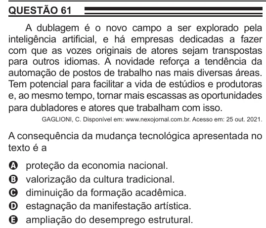

Texto extraído (pode conter ruído)

QUESTÃO 61  
A dublagem é o novo campo a ser explorado pela  
inteligência artificial, e há empresas dedicadas a fazer  
com que as vozes originais de atores sejam transpostas  
para outros idiomas. A novidade reforça a tendência da  
automação de postos de trabalho nas mais diversas áreas.  
Tem potencial para facilitar a vida de estúdios e produtoras  
e, ao mesmo tempo, tornar mais escassas as oportunidades  
para dubladores e atores que trabalham com isso.  
GAGLIONI, C. Disponível em: www.nexojornal.com.br. Acesso em: 25 out. 2021.  
A consequência da mudança tecnológica apresentada no  
texto é a  
proteção da economia nacional.  
A  
valorização da cultura tradicional.  
B  
diminuição da formação acadêmica.  
C  
estagnação da manifestação artística.  
D  
ampliação do desemprego estrutural.  
E

