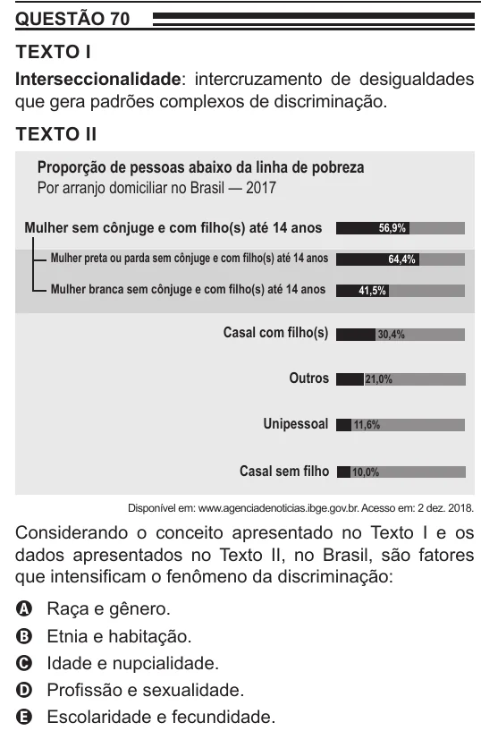

Texto extraído (pode conter ruído)

QUESTÃO 70  
TEXTO I  
Interseccionalidade: intercruzamento de desigualdades  
que gera padrões complexos de discriminação.  
TEXTO II  
Proporção de pessoas abaixo da linha de pobreza  
Por arranjo domiciliar no Brasil — 2017  
Mulher sem cônjuge e com filho(s) até 14 anos  
56,9%  
Mulher preta ou parda sem cônjuge e com filho(s) até 14 anos  
64,4%  
Mulher branca sem cônjuge e com filho(s) até 14 anos  
41,5%  
Casal com filho(s)  
30,4%  
Outros  
21,0%  
Unipessoal  
11,6%  
Casal sem filho  
10,0%  
Disponível em: www.agenciadenoticias.ibge.gov.br. Acesso em: 2 dez. 2018.  
Considerando o conceito apresentado no Texto I e os  
dados apresentados no Texto II, no Brasil, são fatores  
que intensificam o fenômeno da discriminação:  
Raça e gênero.  
A  
Etnia e habitação.  
B  
Idade e nupcialidade.  
C  
Profissão e sexualidade.  
D  
E  
Escolaridade e fecundidade.

