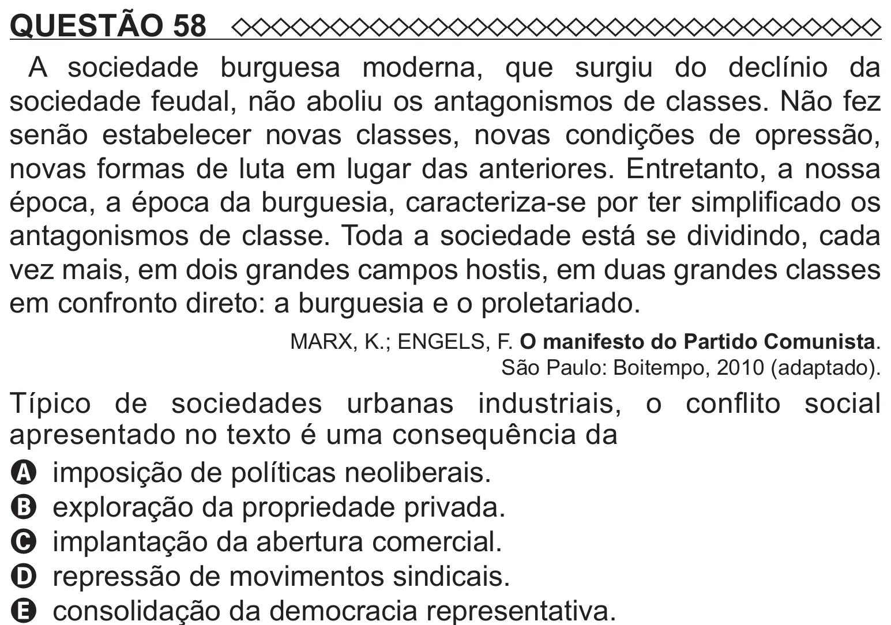

Texto extraído (pode conter ruído)

QUESTÃO 58  
A sociedade burguesa moderna, que surgiu do declínio da  
sociedade feudal, não aboliu os antagonismos de classes. Não fez  
senão estabelecer novas classes, novas condições de opressão,  
novas formas de luta em lugar das anteriores. Entretanto, a nossa  
época, a época da burguesia, caracteriza-se por ter simplificado os  
antagonismos de classe. Toda a sociedade está se dividindo, cada  
vez mais, em dois grandes campos hostis, em duas grandes classes  
em confronto direto: a burguesia e o proletariado.  
MARX, K.; ENGELS, F. O manifesto do Partido Comunista.  
São Paulo: Boitempo, 2010 (adaptado).  
Típico de sociedades urbanas industriais, o conflito social  
apresentado no texto é uma consequência da  
A imposição de políticas neoliberais.  
B exploração da propriedade privada.  
C implantação da abertura comercial.  
D repressão de movimentos sindicais.

