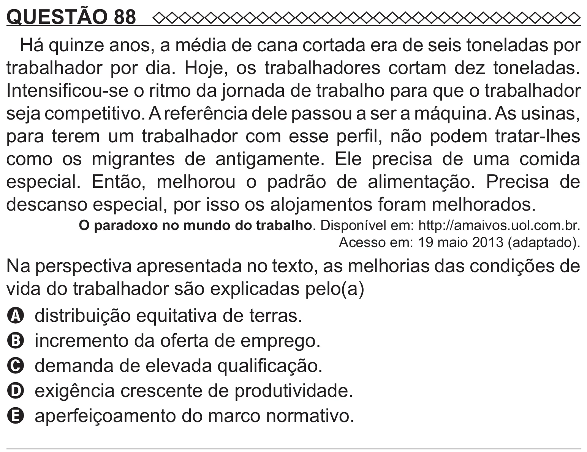

Texto extraído (pode conter ruído)

QUESTÃO 88  
Há quinze anos, a média de cana cortada era de seis toneladas por  
trabalhador por dia. Hoje, os trabalhadores cortam dez toneladas.  
Intensificou-se o ritmo da jornada de trabalho para que o trabalhador  
seja competitivo. A referência dele passou a ser a máquina. As usinas,  
para terem um trabalhador com esse perfil, não podem tratar-lhes  
como os migrantes de antigamente. Ele precisa de uma comida  
especial. Então, melhorou o padrão de alimentação. Precisa de  
descanso especial, por isso os alojamentos foram melhorados.  
O paradoxo no mundo do trabalho. Disponível em: http://amaivos.uol.com.br.  
Acesso em: 19 maio 2013 (adaptado).  
Na perspectiva apresentada no texto, as melhorias das condições de  
vida do trabalhador são explicadas pelo(a)  
A distribuição equitativa de terras.  
B incremento da oferta de emprego.  
C demanda de elevada qualificação.  
D exigência crescente de produtividade.  
E aperfeiçoamento do marco normativo.

