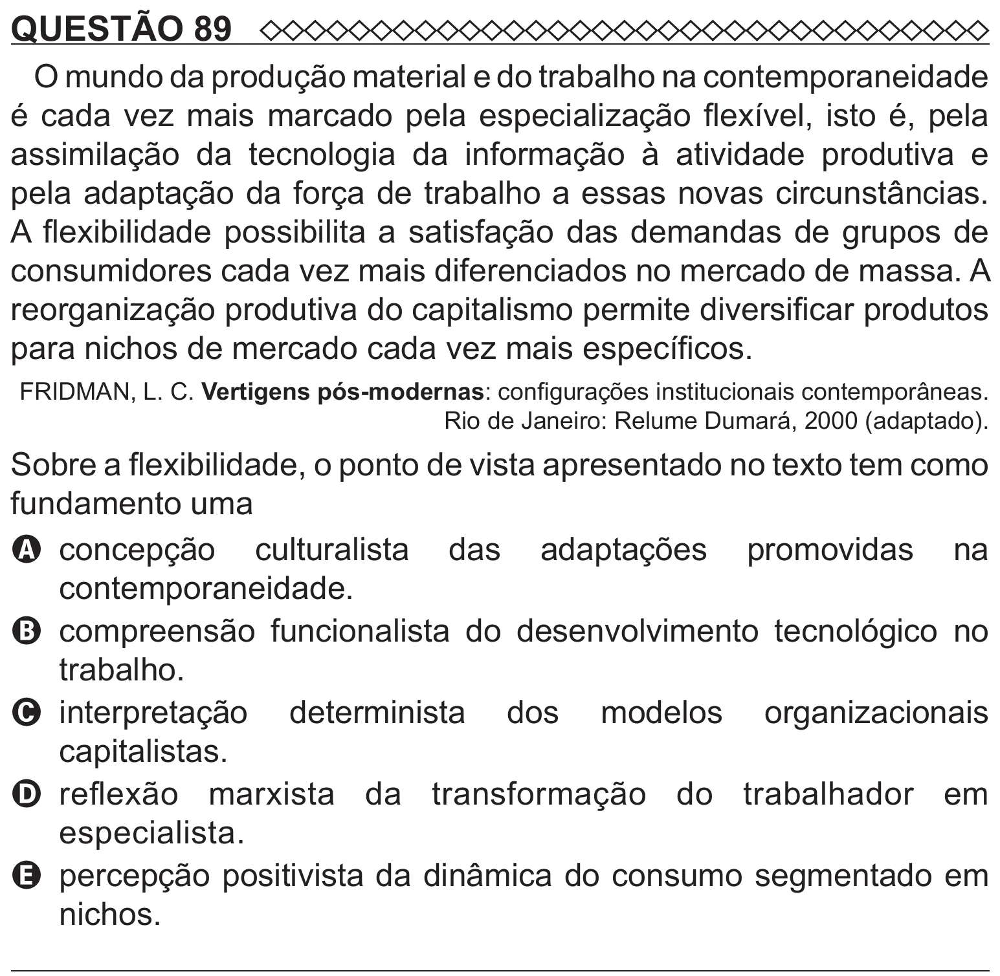

Texto extraído (pode conter ruído)

QUESTÃO 89  
O mundo da produção material e do trabalho na contemporaneidade  
é cada vez mais marcado pela especialização flexível, isto é, pela  
assimilação da tecnologia da informação à atividade produtiva e  
pela adaptação da força de trabalho a essas novas circunstâncias.  
A flexibilidade possibilita a satisfação das demandas de grupos de  
consumidores cada vez mais diferenciados no mercado de massa. A  
reorganização produtiva do capitalismo permite diversificar produtos  
para nichos de mercado cada vez mais específicos.  
FRIDMAN, L. C. Vertigens pós-modernas: configurações institucionais contemporâneas.  
Rio de Janeiro: Relume Dumará, 2000 (adaptado).  
Sobre a flexibilidade, o ponto de vista apresentado no texto tem como  
fundamento uma  
A   
concepção culturalista das adaptações promovidas na  
contemporaneidade.  
B compreensão funcionalista do desenvolvimento tecnológico no  
trabalho.  
C   
interpretação determinista dos modelos organizacionais  
capitalistas.  
D reflexão marxista da transformação do trabalhador em  
especialista.  
E percepção positivista da dinâmica do consumo segmentado em  
nichos.

