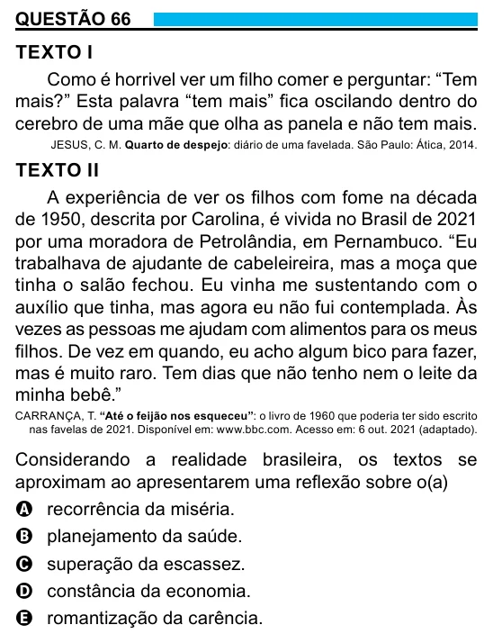

Texto extraído (pode conter ruído)

QUESTÃO 66  
TEXTO I  
Como é horrivel ver um filho comer e perguntar: “Tem  
mais?” Esta palavra “tem mais” fica oscilando dentro do  
cerebro de uma mãe que olha as panela e não tem mais.  
JESUS, C. M. Quarto de despejo: diário de uma favelada. São Paulo: Ática, 2014.  
TEXTO II  
A experiência de ver os filhos com fome na década  
de 1950, descrita por Carolina, é vivida no Brasil de 2021  
por uma moradora de Petrolândia, em Pernambuco. “Eu  
trabalhava de ajudante de cabeleireira, mas a moça que  
tinha o salão fechou. Eu vinha me sustentando com o  
auxílio que tinha, mas agora eu não fui contemplada. Às  
vezes as pessoas me ajudam com alimentos para os meus  
filhos. De vez em quando, eu acho algum bico para fazer,  
mas é muito raro. Tem dias que não tenho nem o leite da  
minha bebê.”  
CARRANÇA, T. “Até o feijão nos esqueceu”: o livro de 1960 que poderia ter sido escrito  
nas favelas de 2021. Disponível em: www.bbc.com. Acesso em: 6 out. 2021 (adaptado).  
Considerando a realidade brasileira, os textos se  
aproximam ao apresentarem uma reflexão sobre o(a)  
A recorrência da miséria.  
B planejamento da saúde.  
C superação da escassez.  
D constância da economia.  
E romantização da carência.

