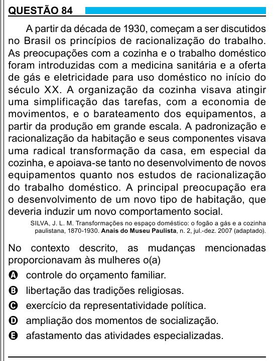

Texto extraído (pode conter ruído)

QUESTÃO 84  
A partir da década de 1930, começam a ser discutidos  
no Brasil os princípios de racionalização do trabalho.  
As preocupações com a cozinha e o trabalho doméstico  
foram introduzidas com a medicina sanitária e a oferta  
de gás e eletricidade para uso doméstico no início do  
século XX. A organização da cozinha visava atingir  
uma simplificação das tarefas, com a economia de  
movimentos, e o barateamento dos equipamentos, a  
partir da produção em grande escala. A padronização e  
racionalização da habitação e seus componentes visava  
uma radical transformação da casa, em especial da  
cozinha, e apoiava-se tanto no desenvolvimento de novos  
equipamentos quanto nos estudos de racionalização  
do trabalho doméstico. A principal preocupação era  
o desenvolvimento de um novo tipo de habitação, que  
deveria induzir um novo comportamento social.  
SILVA, J. L. M. Transformações no espaço doméstico: o fogão a gás e a cozinha  
paulistana, 1870-1930. Anais do Museu Paulista, n. 2, jul.-dez. 2007 (adaptado).  
No contexto descrito, as mudanças mencionadas  
proporcionavam às mulheres o(a)  
A controle do orçamento familiar.  
B libertação das tradições religiosas.  
C exercício da representatividade política.  
D ampliação dos momentos de socialização.  
E afastamento das atividades especializadas.  
29

