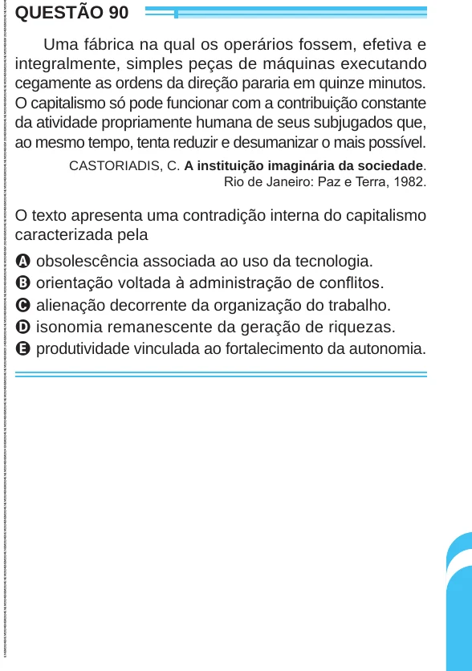

Texto extraído (pode conter ruído)

QUESTÃO 90  
Uma fábrica na qual os operários fossem, efetiva e  
integralmente, simples peças de máquinas executando  
cegamente as ordens da direção pararia em quinze minutos.  
O capitalismo só pode funcionar com a contribuição constante  
da atividade propriamente humana de seus subjugados que,  
ao mesmo tempo, tenta reduzir e desumanizar o mais possível.  
CASTORIADIS, C. A instituição imaginária da sociedade.  
Rio de Janeiro: Paz e Terra, 1982.  
O texto apresenta uma contradição interna do capitalismo  
caracterizada pela  
A obsolescência associada ao uso da tecnologia.  
B orientação voltada à administração de conflitos.  
C alienação decorrente da organização do trabalho.  
D isonomia remanescente da geração de riquezas.  
E produtividade vinculada ao fortalecimento da autonomia.

